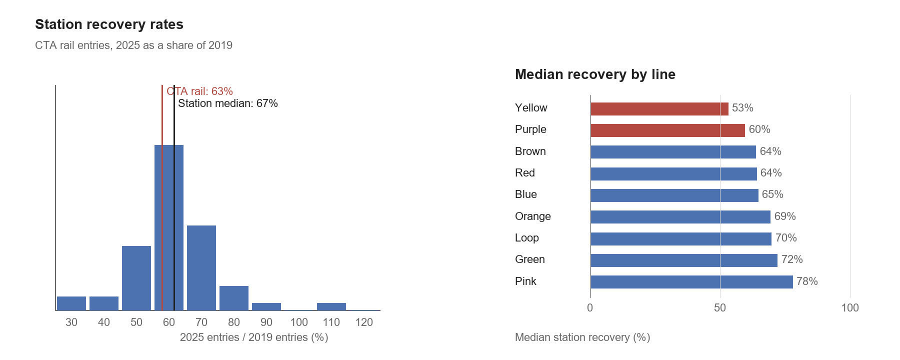

# CTA Rail Ridership Recovery, 2019-2025

This repository contains a short Python analysis of station-level CTA rail
entries and the two-page programming supplement prepared for the University of
Chicago MS in Applied Data Science application.

[View the two-page programming supplement](Zixin_Hu_CTA_Ridership_Recovery_Supplement.pdf)

## Research question

Which CTA rail stations lagged the system's recovery between 2019 and 2025?

The analysis uses annual station entry totals from the CTA Annual Ridership
Reports. Each report yields 142 station totals. Matching but excluding one
closed station in 2019 and one new station in 2025 leaves 141 common stations.
Kostner is then removed by the 100,000-entry 2019 threshold, leaving 140 rows in
the recovery table. Two stations reopened in July 2025 and are retained in the
data but marked as non-comparable for the recovery analysis.

## Main result

The median comparable station recovery was 66.2% of 2019 entries in 2025. The five most
slowly recovering stations were Oak Park, Pulaski, Racine, Austin, and Forest
Park. All five are on the Blue Line's Forest Park branch.



## Files

- `supplement_code.py`: analysis code shown in the two-page PDF
- `cta_recovery_analysis.py`: full analysis and chart function
- `cta_extract.py`: parser that rebuilds the station CSVs from the two CTA reports
- `2019_Annual_Ridership_Report.pdf` and `2025_Annual_Ridership_Report.pdf`: official source reports
- `cta_station_entries_2019.csv`: all 142 CTA station totals extracted from the 2019 report
- `cta_station_entries_2025.csv`: all 142 CTA station totals extracted from the 2025 report
- `cta_station_recovery.csv`: 140 matched stations with a `comparable` flag
- `validate_data.py`: checks row counts, keys, exclusions, and the reported median
- [DATA_DICTIONARY.md](DATA_DICTIONARY.md): field definitions and processing rules
- [Zixin_Hu_CTA_Ridership_Recovery_Supplement.pdf](Zixin_Hu_CTA_Ridership_Recovery_Supplement.pdf): final two-page PDF
- `requirements.txt`: Python dependencies

## Data sources

- [CTA Annual Ridership Report, Calendar Year 2019](https://www.transitchicago.com/assets/1/6/2019_Annual_Ridership_Report.pdf)
- [CTA Annual Ridership Report, Calendar Year 2025](https://www.transitchicago.com/assets/1/6/2025_Annual_Ridership_Report.pdf)
- [CTA ridership report index](https://www.transitchicago.com/ridership/)

## Run the analysis

```bash
python -m pip install -r requirements.txt
python cta_extract.py
python validate_data.py
python supplement_code.py
```

`cta_extract.py` rebuilds the 142-row annual files and the 140-row matched
recovery table. `supplement_code.py` reads `cta_station_recovery.csv`, filters
to the 138 comparable stations, prints the station and line summaries, and
writes `cta_recovery.png`.

## Interpretation limits

- Station entries count boardings, not unique riders.
- Ridership is a usage measure, not a complete measure of accessibility.
- CTA changed its 2025 ridership processing methodology, so the two years are
  not perfectly comparable.
- The results are descriptive and should not be read as causal effects.
